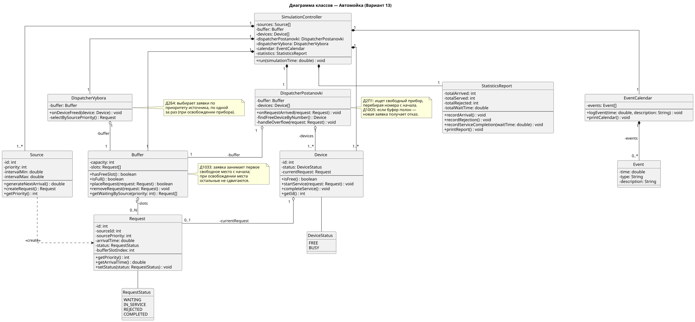
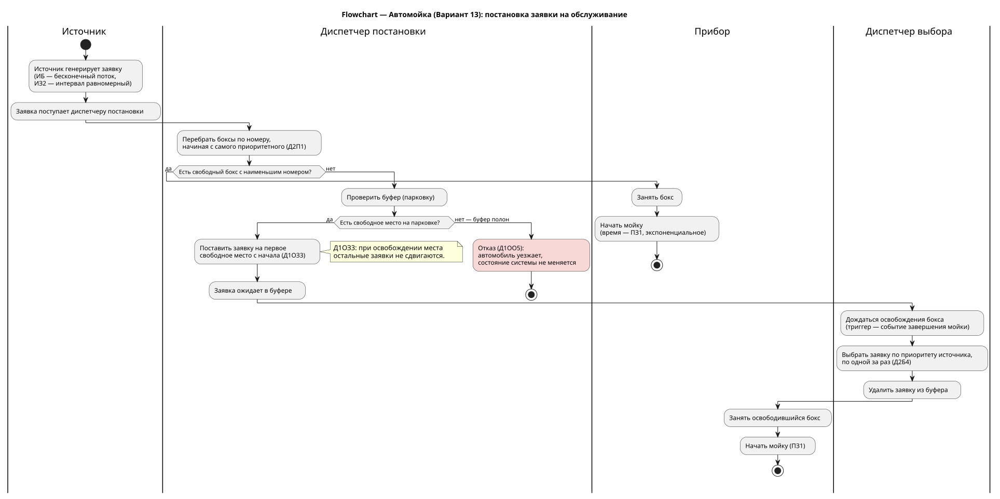
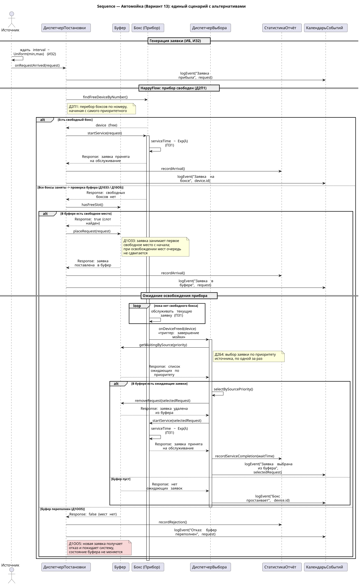

# SMO_Variant13 — Курсовая по имитационному моделированию

**Вариант:** 13
**Бизнес-домен:** Автомойка (сервис распределения автомобилей по боксам)

**Код варианта:** ИБ, ИЗ2, ПЗ1, Д1ОЗ3, Д1ОО5, Д2П1, Д2Б4, ОР1, ОД1

| Код | Расшифровка |
|---|---|
| ИБ | Источник бесконечный: поток заявок неограничен |
| ИЗ2 | Интервалы между поступлением заявок распределены равномерно |
| ПЗ1 | Время обслуживания заявки на приборе распределено экспоненциально |
| Д1ОЗ3 | Заявка занимает первое свободное место буфера с начала; при освобождении мест очередь не сдвигается |
| Д1ОО5 | При переполнении буфера отказ получает вновь поступившая заявка |
| Д2П1 | Выбор прибора — перебор по номеру, начиная с самого приоритетного |
| Д2Б4 | Выбор заявок из буфера — по приоритету источника, по одной заявке за раз |
| ОР1 | Результат моделирования — сводная таблица |
| ОД1 | Отображение — календарь событий с текущим состоянием буфера и приборов |

## Файлы

- `classes.puml` / `classes.svg` — диаграмма классов
- `flowchart.puml` / `flowchart.svg` — flowchart с дорожками (все альтернативы процесса)
- `sequence.puml` / `sequence.svg` — единый sequence-сценарий со всеми alt/loop

## Диаграмма классов

## Flowchart

## Sequence

