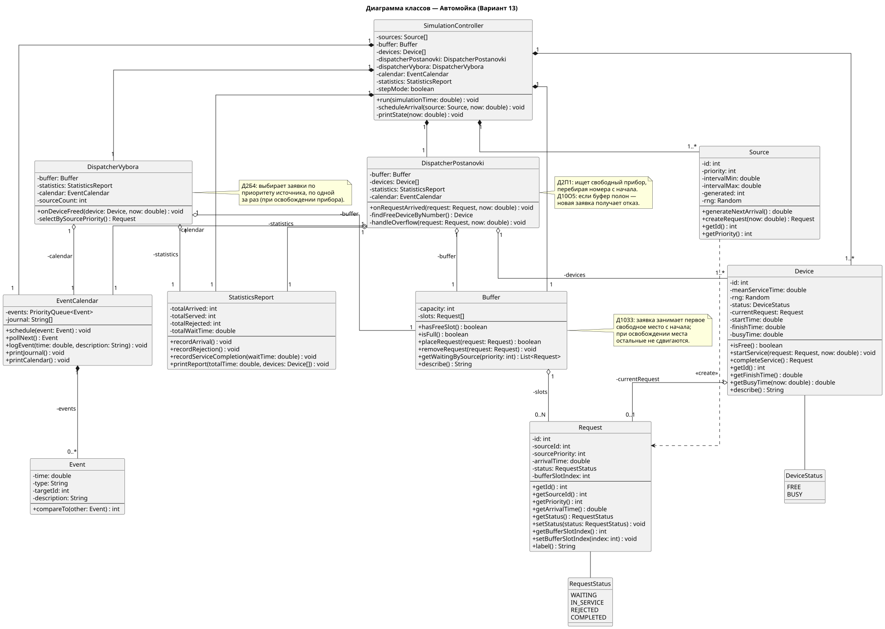
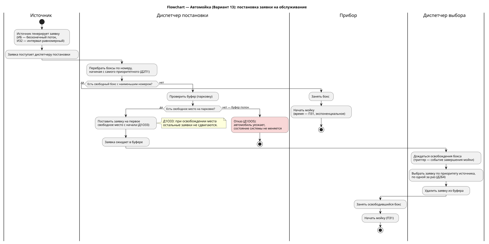
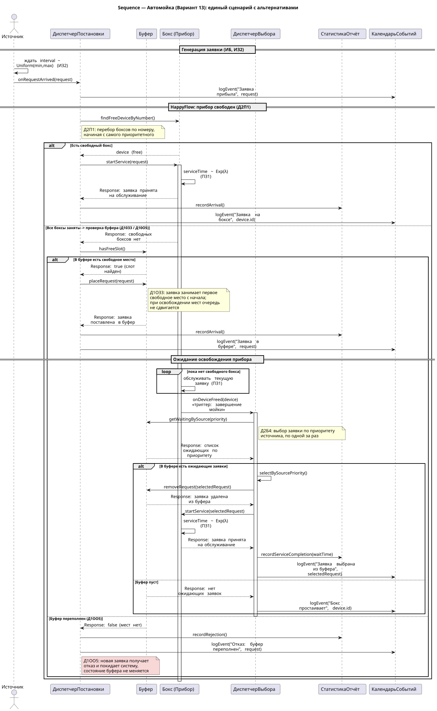

# SMO_Variant13 — Курсовая по имитационному моделированию

**Вариант:** 13
**Бизнес-домен:** Автомойка (сервис распределения автомобилей по боксам)

**Код варианта:** ИБ, ИЗ2, ПЗ1, Д1ОЗ3, Д1ОО5, Д2П1, Д2Б4, ОР1, ОД1

| Код | Расшифровка |
|---|---|
| ИБ | Источник бесконечный: поток заявок неограничен |
| ИЗ2 | Интервалы между поступлением заявок распределены равномерно |
| ПЗ1 | Время обслуживания заявки на приборе распределено экспоненциально |
| Д1ОЗ3 | Заявка занимает первое свободное место буфера с начала; при освобождении мест очередь не сдвигается |
| Д1ОО5 | При переполнении буфера отказ получает вновь поступившая заявка |
| Д2П1 | Выбор прибора — перебор по номеру, начиная с самого приоритетного |
| Д2Б4 | Выбор заявок из буфера — по приоритету источника, по одной заявке за раз |
| ОР1 | Результат моделирования — сводная таблица |
| ОД1 | Отображение — календарь событий с текущим состоянием буфера и приборов |

## Файлы

- `classes.puml` / `classes.svg` — диаграмма классов
- `flowchart.puml` / `flowchart.svg` — flowchart с дорожками (все альтернативы процесса)
- `sequence.puml` / `sequence.svg` — единый sequence-сценарий со всеми alt/loop

## Запуск в IntelliJ IDEA

1. File → Open → выбрать папку проекта (откроется как Maven-проект, нужен JDK 17+).
2. Справа вверху в списке конфигураций выбрать **Main (step)** (пошаговый режим, Enter в консоли — следующий шаг) или **Main (auto)** (сводная таблица ОР1) и нажать Run.
3. Параметры меняются в Run → Edit Configurations → Program arguments:
   `режим [время] [боксы] [мест в буфере] [seed]`, например `step 120 2 3 42`.

## Структура

- `src/main/java` — исходники (классы из диаграммы классов).
- `docs/` — `classes`, `flowchart`, `sequence` (`.puml` и `.svg`).

## Диаграмма классов

## Flowchart

## Sequence

## Программа (Java, консоль)

Модель построена по принципу особых событий: шаг — переход к ближайшему событию (приход заявки, освобождение бокса, конец моделирования).

Параметры: `режим [время] [боксы] [мест в буфере] [seed]`. По умолчанию: step, 120, 2 бокса, 3 места, seed 42.
Источники: 3 штуки, интервалы между заявками равномерные (ИЗ2): И1 — 8–16, И2 — 10–20, И3 — 15–25; среднее время мойки 9 (экспоненциальное, ПЗ1).
Если в Windows-консоли вместо русских букв «кракозябры», выполните `chcp 65001`.

| Класс диаграммы | Файл |
|---|---|
| Source, Request, Buffer, Device | `Source.java`, `Request.java`, `Buffer.java`, `Device.java` |
| DispatcherPostanovki (Д2П1, Д1ОЗ3, Д1ОО5) | `DispatcherPostanovki.java` |
| DispatcherVybora (Д2Б4) | `DispatcherVybora.java` |
| EventCalendar, Event (ОД1) | `EventCalendar.java`, `Event.java` |
| StatisticsReport (ОР1) | `StatisticsReport.java` |
| SimulationController | `SimulationController.java`, запуск — `Main.java` |
